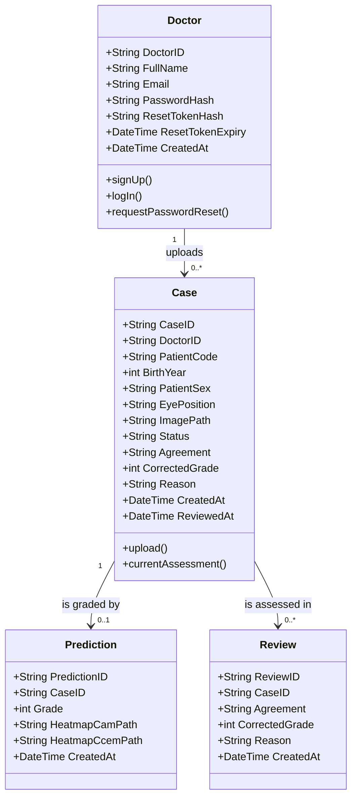

# Use Case and Class Model
## RetinaX.ai — as built, 8 September 2026

The diagrams below describe the **implemented** system. Where they differ from the
StarUML model drawn at design time, §3 lists exactly what to change and why.

---

## 1 · Use case diagram

```mermaid
graph LR
  D(("Doctor")):::actor
  M(("Grading&nbsp;Model")):::actor

  subgraph RetinaX["RetinaX.ai"]
    UC1["UC-1<br/>Log in"]
    UC8["UC-8<br/>Create account"]
    UC7["UC-7<br/>Recover password"]
    UC2["UC-2<br/>Upload case"]
    UC3["UC-3<br/>Grade image"]
    UC4["UC-4<br/>View cases"]
    UC5["UC-5<br/>Review result"]
    UC6["UC-6<br/>Record assessment"]
    UC9["UC-9<br/>Request CCEM<br/>explanation"]
    UC10["UC-10<br/>Retry grading"]
  end

  D --- UC1
  D --- UC8
  D --- UC7
  D --- UC2
  D --- UC4
  D --- UC5
  UC3 --- M

  UC2 -. "&laquo;include&raquo;" .-> UC3
  UC5 -. "&laquo;extend&raquo;" .-> UC6
  UC5 -. "&laquo;extend&raquo;" .-> UC9
  UC5 -. "&laquo;extend&raquo;" .-> UC10

  classDef actor fill:#c05517,stroke:#7a340e,color:#fff;
```



Arrow direction note: an `extend` points **from** the extending use case **to**
the one it extends. UC-6, UC-9 and UC-10 each extend UC-5.

### 1.1 Use case descriptions

| ID | Name | Actor | Summary |
|---|---|---|---|
| UC-1 | Log in | Doctor | Authenticate with email and password; optionally stay signed in for 14 days. |
| UC-2 | Upload case | Doctor | Submit a fundus photograph with patient code and eye position. Both eyes may be entered together; each photograph becomes its own case. |
| UC-3 | Grade image | Grading Model | Preprocess, run the network with test-time augmentation, convert the score to an ICDR grade, and render a Grad-CAM++ map. |
| UC-4 | View cases | Doctor | Browse the worklist, grouped by patient, searchable and filterable. |
| UC-5 | Review result | Doctor | Open a case: photograph, model grade, explanation overlays. |
| UC-6 | Record assessment | Doctor | Agree with the grade, or disagree with a corrected grade and a reason. May be repeated to amend; every version is retained. |
| UC-7 | Recover password | Doctor | Request a single-use, time-limited reset link and set a new password. |
| UC-8 | Create account | Doctor | Self-service registration. A demonstration decision — see SRS §6.2. |
| UC-9 | Request CCEM explanation | Doctor | Ask for the fused explanation map, which is too expensive to compute on upload. |
| UC-10 | Retry grading | Doctor | Re-run grading on a case whose grading failed, without re-uploading. |

### 1.2 UC-6 — Record assessment, in detail

**Precondition** — the case belongs to this doctor and has status `GRADED` or
`REVIEWED`.

| # | Actor | Step |
|---|---|---|
| 1 | Doctor | Opens the case and reads the photograph and the explanation overlay |
| 2 | Doctor | Chooses Agree or Disagree |
| 3a | Doctor | *(Agree)* Saves |
| 3b | Doctor | *(Disagree)* Selects a corrected grade 0–4 and writes a reason |
| 4 | System | Refuses a disagreement lacking a grade or a reason — **BR-3** |
| 5 | System | Appends the assessment to `Review`; the model's prediction is untouched — **BR-4** |
| 6 | System | Updates the case's current assessment and sets status `REVIEWED` |

**Alternate flow — amendment.** From step 1, if the case is already `REVIEWED`,
the doctor may choose *Change my assessment* and the flow proceeds identically.
The earlier assessment is not modified; a new `Review` is appended and the case's
current values are updated. History is visible on the case.

**Exception** — a case with no grade (`PROCESSING` or `FAILED`) offers no review
controls, and the API refuses with 409 — **BR-2**.

---

## 2 · Class diagram



### 2.1 What each relationship means in the code

| Relationship | Mechanism |
|---|---|
| `Doctor 1 → 0..* Case` | `cases.DoctorID` foreign key. Every case query filters on it — this *is* BR-1. |
| `Case 1 → 0..1 Prediction` | `UNIQUE` constraint on `predictions.CaseID`. At most one model grade per case, written once and never updated. |
| `Case 1 → 0..* Review` | Append-only. The case row carries the *current* assessment so nothing that reads a case needs to know the history exists; `Review` carries every version. |

### 2.2 Status values

```
PROCESSING → GRADED → REVIEWED
     ↓                    ↑
  FAILED ──── retry ──────┘
```

| Status | Meaning | Review offered |
|---|---|---|
| `PROCESSING` | Uploaded, model running | no |
| `GRADED` | A grade exists, awaiting the doctor | **yes** |
| `REVIEWED` | The doctor has recorded an assessment | yes, as an amendment |
| `FAILED` | The model could not be reached or errored | no; offers retry |

### 2.3 Attributes stored as something other than they are named

| Class attribute | Stored as | Why |
|---|---|---|
| `Doctor.Password` | `PasswordHash` — bcrypt | A password is never stored |
| `Doctor.ResetToken` | `ResetTokenHash` — SHA-256, with an expiry | A stolen database must not yield working reset links |

---

## 3 · Changes to make in StarUML

The design-time model predates several decisions. Each change below is a
correction to the diagram, not to the code.

### 3.1 Class diagram

| # | Change | Why |
|---|---|---|
| 1 | **Remove `Score` from `Prediction`** | The regression score and the decision thresholds stay inside the grading service. The application receives a grade, never a score, and there is no `Score` column. |
| 2 | **Add `ReviewedAt : DateTime` to `Case`** | The code records when the assessment was made; the diagram did not list it. |
| 3 | **Replace `Heatmap` with `HeatmapCamPath` and `HeatmapCcemPath`** | The case screen offers two explanation methods and they must not be the same picture under different labels. Grad-CAM++ is produced on upload; CCEM is produced on request and is therefore nullable in a way the first is not. |
| 4 | **Add the `Review` class**, with `Case 1 → 0..*` | New. An assessment can be amended, and every version is kept. This relationship is the project's central claim expressed in one line: one case, one model grade, many human assessments, none of which can overwrite it. |

### 3.2 Use case diagram

| # | Change | Why |
|---|---|---|
| 5 | **Add UC-8 Create account** | Self-service registration exists. Add it as a use case with a note that a hospital deployment would provision accounts centrally — see SRS §6.2. |
| 6 | **Add UC-9 Request CCEM explanation**, extending UC-5 | CCEM is optional and expensive, which is exactly what `extend` means. |
| 7 | **Add UC-10 Retry grading**, extending UC-5 | Optional behaviour on a complete use case, available only in the failure state. |

### 3.3 What deliberately stays off the diagram

`POST /api/logout`, `GET /api/me`, `GET /api/cases/:id/image` and
`GET /api/cases/:id/heatmap/:method` are session mechanics and file serving. They
carry no user goal, so they are not use cases. A marker counting HTTP routes
against use cases will notice the difference; this is the reason.

---

## 4 · Traceability

Requirement identifiers used above are defined in [`SRS.md`](SRS.md). The mapping
from each use case and class to the file and route that implements it is in
[`../TRACEABILITY.md`](../TRACEABILITY.md), which also lists the commands a marker
can run to verify each business rule in about five minutes.
