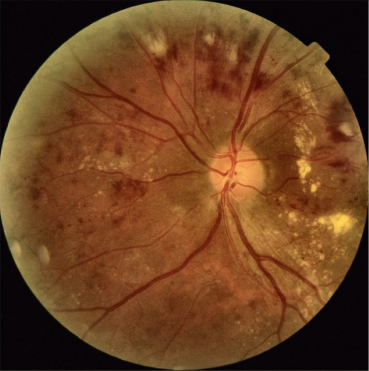
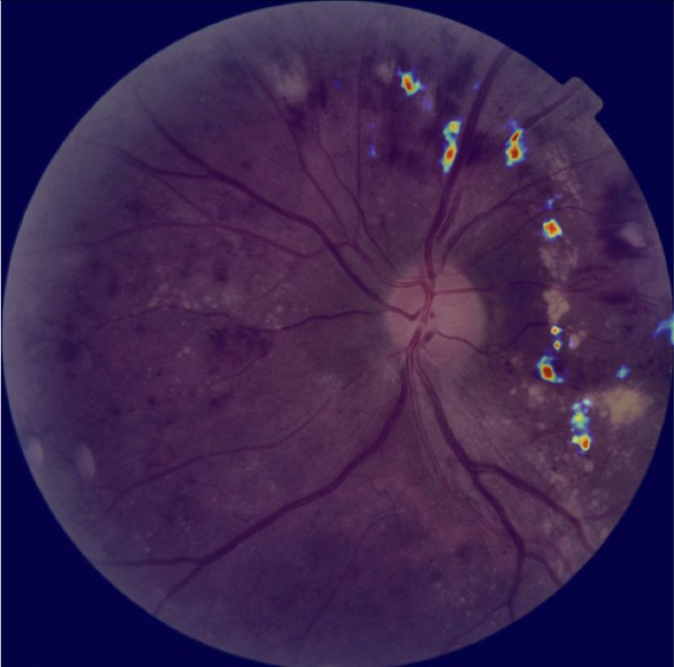
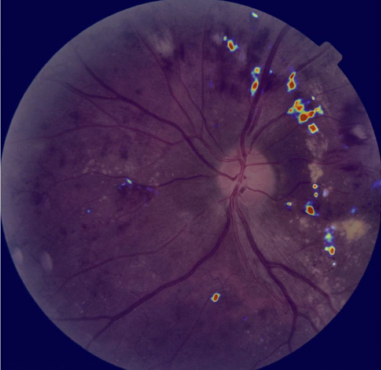

<h1 align="center">RetinaX.ai</h1>

<p align="center">
  <b>Explainable diabetic retinopathy screening support for ophthalmologists.</b><br>
  The AI proposes a grade and shows its evidence. The doctor decides.
</p>

<p align="center">
  <a href="https://retinax.pages.dev"><b>Live demo</b></a> ·
  <a href="https://github.com/JayNguyen0505-es/DR-CCEM"><b>Research code (DR-CCEM)</b></a> ·
  <a href="#run-it-locally">Run locally</a> ·
  <a href="#architecture">Architecture</a> ·
  <a href="#license">License</a>
</p>

<p align="center">
  🏆 <b>First Prize, USTH Student Scientific Research Competition 2026</b><br>
  Built on the research project <i>Lesion-Aware Explainable AI Diabetic Retinopathy Grading on Fundus Images</i>,
  with the Analytics Everywhere Lab (University of New Brunswick) and USTH.
</p>

<table align="center">
  <tr>
    <td align="center"><br><sub>Fundus photograph</sub></td>
    <td align="center"><br><sub>Grad-CAM++ (on upload)</sub></td>
    <td align="center"><br><sub>CCEM (proposed method)</sub></td>
  </tr>
</table>

> [!WARNING]
> **RetinaX.ai is not a medical device** and must not be used to diagnose, screen or treat anyone. It is research, education and demonstration software. Every AI grade must be confirmed by a qualified clinician. The full clinical disclaimer is in [NOTICE](NOTICE).

---

## Two repositories, one project

| Repository | What it holds |
|---|---|
| **[DR-CCEM](https://github.com/JayNguyen0505-es/DR-CCEM)** | The research: the three-stage training pipeline for the grading model, the CCEM explanation method, and the explanation benchmark against expert lesion masks. |
| **RetinaX** (this repo) | The application that puts that research in front of a doctor: web app, API, case workflow, and a model service that loads the DR-CCEM code at runtime. |

RetinaX does not copy the research code. Its model service imports the grading model, preprocessing, explainers and CCEM fusion directly from a DR-CCEM checkout (see [Using the real model](#using-the-real-model)), so the app always runs the same code the results were measured with.

## What it does

A doctor uploads a fundus photograph. The model service returns a **DR grade (0–4)** on the International Clinical DR scale, an **explanation heatmap** and **lesion marks**. The doctor then agrees, or overrides the grade with a written reason.

**The doctor's answer is the diagnosis of record. The model never overwrites it, and the model's own grade is never overwritten either.** Both are kept side by side, and every disagreement becomes a training signal for the next model version.

- **Ordinal DR grading.** EfficientNet-B7 (Noisy Student) + CBAM regression model, with three-view test-time augmentation and Nelder-Mead-optimised thresholds that turn the score into a grade.
- **Two explanation maps.** Grad-CAM++ appears instantly on upload. **CCEM** (Consensus-Calibrated Explanation Map), the project's proposed method, is computed after it.
- **Lesion localisation** for six lesion types (MA, HE, EX, SE, IRMA, NV) using separate lesion models trained on FGADR. NV is shown as "not assessed" because its recall is not yet credible.
- **Fundus gate.** A CLIP-based check rejects images that are not fundus photographs before they reach the grader.
- **Case assistant.** A local LLM (via Ollama) can discuss a case with the doctor but has **no write path**. Clinician notes are fenced so they cannot act as prompt injection.
- **Doctor accounts** with email confirmation, approval of new browsers, password reset, rate limiting, and hashed, expiring tokens.
- **Light and dark themes**, with severity colours reserved for the DR grade only.

## The research behind it

The full method, training scripts and evaluation live in **[DR-CCEM](https://github.com/JayNguyen0505-es/DR-CCEM)**. In short:

**Grading model.** Trained in three stages: pre-training on EyePACS 2015, fine-tuning on APTOS 2019 and Messidor-2, then attention-guided fine-tuning in which MAPLES-DR expert lesion masks supervise the CBAM module.

| Grading metric | Value |
|---|---|
| APTOS 2019 validation QWK | **0.93** |
| Kaggle private leaderboard QWK | **0.92** |

<sub>QWK = quadratic weighted kappa. These come from the research model on public datasets and say nothing about performance on any real clinic's images.</sub>

**CCEM.** Single explanation methods disagree: Grad-CAM++ is coarse, Ada-SISE is sharp but narrow, SmoothIG is noisy. CCEM fuses all three into one map:

1. resizes the three maps to a common grid and normalises them by percentile, so outlier pixels cannot dominate;
2. scores each explainer's reliability **per image** (quick deletion faithfulness, agreement with the others, compactness, containment in the retina, peak dominance) and turns those scores into soft fusion weights;
3. favours regions supported by more than one explainer without requiring all of them, and suppresses saliency outside the fundus;
4. lightly smooths and filters the result, with fallbacks so a valid explanation is never erased.

Expert lesion masks are used only to **evaluate** the fused map, never to build it. RetinaX runs CCEM in this `adaptive_reliability` mode.

Explanation quality against MAPLES-DR expert lesion masks (DR-CCEM benchmark run):

| Method | EBPG ↑ | SoftPG ↑ | P@1 ↑ | DPG ↓ | Deletion ↓ | Insertion ↑ | OA ↑ |
|---|---:|---:|---:|---:|---:|---:|---:|
| Grad-CAM++ | 5.86% | 43.19% | 2.96% | 0.422 | 0.6944 | **0.7038** | 0.0093 |
| Ada-SISE | 3.46% | 30.18% | 2.96% | **0.130** | 0.6394 | 0.6456 | 0.0062 |
| SmoothIG | **10.53%** | 56.83% | **8.71%** | 0.344 | 0.6437 | 0.6910 | 0.0474 |
| **CCEM (adaptive)** | 9.19% | **68.03%** | 7.78% | 0.279 | **0.5719** | 0.6835 | **0.1117** |

CCEM gives the best soft pointing score, the lowest deletion AUC and more than double the overall faithfulness (OA = insertion − deletion) of the best single method. Metric definitions and the exact setup are in the DR-CCEM README.

## Architecture

Three processes, by design:

```
web/      React 18 + Vite        the doctor's screens and the public landing page
server/   Express + SQLite       accounts, cases, business rules, assistant proxy
ai/       FastAPI + PyTorch      grading model, explanation maps, lesion models, fundus gate
```

The model runs behind its own HTTP service rather than inside the API: it is a Python model and the API is Node, and the regression score and thresholds must stay inside the model service. Only the grade, the explanation maps and the lesion regions leave it.

`/` is a public landing page, styled under `.rx-landing` so it cannot leak into the app. Every other route requires a session and redirects to `/login`.

### Data model

| Table | Holds |
|---|---|
| `doctors` | account, bcrypt password hash, hashed confirmation and reset tokens |
| `cases` | patient code, birth year, sex, eye, image, status and the current assessment |
| `predictions` | the model's grade, explanation maps, attention regions and lesion maps. **Write-once.** |
| `reviews` | the full assessment history. An amendment appends; it never overwrites. |
| `trusted_devices`, `login_verifications`, `revoked_sessions`, `auth_attempts` | sessions and rate limiting. Every token is stored as a SHA-256 hash and every row expires. |

No patient names are stored, only a patient code and a birth year.

### Business rules

| | Rule | Enforced in |
|---|---|---|
| BR-1 | A doctor can only reach their own cases. Another doctor's case returns **404, not 403**, so its existence is not revealed. | `ownCase()` in `server/server.js` |
| BR-2 | A case can only be marked after it has been graded (`409`). | `POST /api/cases/:id/mark` |
| BR-3 | Disagreeing requires **both** a grade 0–4 **and** a written reason (`400`). | `POST /api/cases/:id/mark` |
| BR-4 | The doctor's correction never touches `predictions.Grade`. | the `UPDATE` names only `cases` columns |
| BR-5 | One image per eye per patient code (`409 DUPLICATE_EYE`). | `eyeTaken()` |
| BR-6 | Birth year and sex describe the patient, not the photograph (`409 PATIENT_MISMATCH`). | `patientIdentity()` |
| BR-7 | A reviewed case cannot be deleted without explicit confirmation (`428`). | `DELETE /api/cases/:id` |
| BR-8 | The assistant has no write path. Neither chat route touches SQL. | `server/chat.js`, `ai/main.py` |

## Run it locally

Requirements: **Python 3.10+**, **Node.js 20.12+**. A GPU is optional. Without real weights the AI service runs a stand-in model, so the whole stack still works end to end.

```bash
# 1. Model service
cd ai
pip install -r requirements.txt
uvicorn main:app --port 8000

# 2. API
cd server
npm install
cp .env.example .env      # set JWT_SECRET to a long random string
npm run seed              # creates two demo doctors
npm run dev               # http://localhost:3000

# 3. Front end
cd web
npm install
npm run dev               # http://localhost:5173
```

Sign in with a seeded demo account: `quang@retinax.ai` / `retinax123`.

[SETUP.md](SETUP.md) is the full first-run guide (Windows and DGX Spark).

### Using the real model

`ai/dr_adapter.py` loads the research model from a **DR-CCEM** checkout when these variables are set, and falls back to the stand-in when they are not:

```bash
git clone https://github.com/JayNguyen0505-es/DR-CCEM.git
export DR_REPO=$PWD/DR-CCEM
export MODEL_PATH=/path/to/stage2_best_model.pth       # trained in DR-CCEM
export THRESHOLD_PATH=/path/to/best_thresholds.npy     # from the same training run
```

The adapter imports `model`, `preprocessing`, the three explainers and `ccem_core` from DR-CCEM's `src/` tree. Model weights and datasets are not included in either repository; the grading model is trained with DR-CCEM's pipeline.

`GET /health` on the model service reports `model_loaded` and where the thresholds came from. If `thresholds_source` says the thresholds are unfitted, grades are coming from naive rounding and are miscalibrated. See [ai/README.md](ai/README.md) for benchmarking and GPU notes.

## Deployment

| Component | Runs on |
|---|---|
| Front end | **Cloudflare Pages** (`retinax.pages.dev`), rebuilt on every push to `main` |
| API, SQLite, uploaded images | an always-on Linux host, behind a Cloudflare tunnel |
| Grading model and GPU | an NVIDIA DGX Spark, reached over Tailscale |

Request path: browser → Pages → Pages Function proxying `/api/*` → tunnel → API → (on upload only) the model service.

Two things to know before changing anything:

- **The `/api/*` proxy is required, not an optimisation.** Without it the session cookie is third-party, and Safari, Firefox and incognito Chrome block it: login looks successful, then every request returns 401. Keep `VITE_API_URL` unset in Pages and set `API_ORIGIN` instead.
- **Never host the API on ephemeral storage.** The database and uploads live only on the API host and are excluded from the deploy archive on purpose.

Runbooks: [DEPLOY.md](DEPLOY.md) for deploying, [docs/OPERATIONS.md](docs/OPERATIONS.md) for incidents, and `bash tools/status.sh` to check every service and which commit is running.

## API overview

All routes need the session cookie except sign-up, login and password reset.

| Method | Route | Purpose |
|---|---|---|
| `POST` | `/api/signup`, `/api/login`, `/api/logout` | account and session |
| `GET` | `/api/email/verify`, `/api/login/verify` | confirm an address, approve a new browser |
| `POST` | `/api/password/forgot`, `/api/password/reset` | single-use, 30-minute reset token; same answer whether or not the address exists |
| `GET` / `POST` | `/api/cases` | list own cases / upload a new one (graded on upload) |
| `GET` / `DELETE` | `/api/cases/:id` | view / delete (`428` if reviewed) |
| `POST` | `/api/cases/:id/mark` | `{agreement, correctedGrade?, reason?}` |
| `POST` | `/api/cases/:id/details` | correct patient details across that patient's eyes |
| `POST` | `/api/cases/:id/regrade`, `/explain` | re-run the model or redraw a map; never writes `Grade` |
| `POST` | `/api/cases/:id/chat`, `/api/chat` | case discussion and app help; **writes nothing** |
| `GET` | `/api/cases/:id/image`, `/heatmap/:method` | images and maps |
| `GET` | `/api/health` | build, database, model, assistant and mail status |

## Repository layout

```
web/                    React front end
  src/landing/          public landing page (scoped CSS)
  src/pages/            Login · Cases · NewCase · CaseDetail
  functions/api/        Cloudflare Pages Function proxying /api/*
server/                 Express API: routes, auth, business rules, mail, assistant proxy
  demo-images/          public-dataset demo images + precomputed results (never real patients)
ai/                     FastAPI service: grading, CAM/CCEM via DR-CCEM, lesion models, fundus gate
tools/                  deploy archives, status checks, backups, seeding, dataset sampling
docs/OPERATIONS.md      what to do when something is down
SETUP.md · DEPLOY.md    first-run guide and deployment runbook
KNOWN-ISSUES.md         open items and resolved issues
LICENSE · NOTICE        Apache-2.0, attributions, dataset terms, clinical disclaimer
```

## Data

No real patient images are in this repository, and none may be added. The project used these public datasets, none of which is redistributed here; each remains under its own terms:

| Dataset | Used for |
|---|---|
| APTOS 2019, EyePACS 2015, Messidor-2 | training and validating the grading model (in DR-CCEM); demo images |
| MAPLES-DR | expert lesion masks for attention supervision and explanation benchmarks (in DR-CCEM) |
| FGADR | training the six lesion models (in `ai/`), under a signed data-use agreement |

Sources and citation requirements are in [NOTICE](NOTICE).

## Known limitations

- Lesion marks have been checked by eye on a handful of cases, not measured against ground-truth masks.
- The model has not been validated on cameras, populations or acquisition conditions outside the public datasets.
- The demo deployment depends on a single quick tunnel and has no off-machine backup yet.

Details and the history of fixed issues are in [KNOWN-ISSUES.md](KNOWN-ISSUES.md).

## Authors

- **Nguyen Truong Thinh** · [@JayNguyen0505-es](https://github.com/JayNguyen0505-es)
- **Nguyen Hai Phong** · [@Xx-Pumpkin-xX](https://github.com/Xx-Pumpkin-xX)

Developed at the University of Science and Technology of Hanoi (USTH), in collaboration with the [Analytics Everywhere Lab](https://www.cs.unb.ca/~hcao3/), University of New Brunswick.

## License

Copyright © 2026 [Nguyen Truong Thinh](https://github.com/JayNguyen0505-es) and [Nguyen Hai Phong](https://github.com/Xx-Pumpkin-xX).

The source code in **this repository** is licensed under the **Apache License, Version 2.0**. See [LICENSE](LICENSE). You may use, modify and redistribute it, including commercially, provided you keep the copyright and license notices, state the changes you made, and ship the [NOTICE](NOTICE) file with any redistribution. Apache-2.0 was chosen over MIT because it grants patent rights explicitly and requires modified versions to say what changed.

What this license does **not** cover:

- **The DR-CCEM research code** is a separate repository under its own terms. Apache-2.0 here grants no rights to it.
- **Model weights** are not distributed and not licensed. The lesion models are derived from FGADR under a data-use agreement and must never be published.
- **Datasets and demo images** remain under the terms of their original providers (APTOS 2019, EyePACS, Messidor-2, MAPLES-DR, FGADR).
- **Clinical use.** The license grants no right to use this software on patients. RetinaX.ai is provided as is, without warranty, under Sections 7 and 8 of the license. See the clinical disclaimer in [NOTICE](NOTICE).
